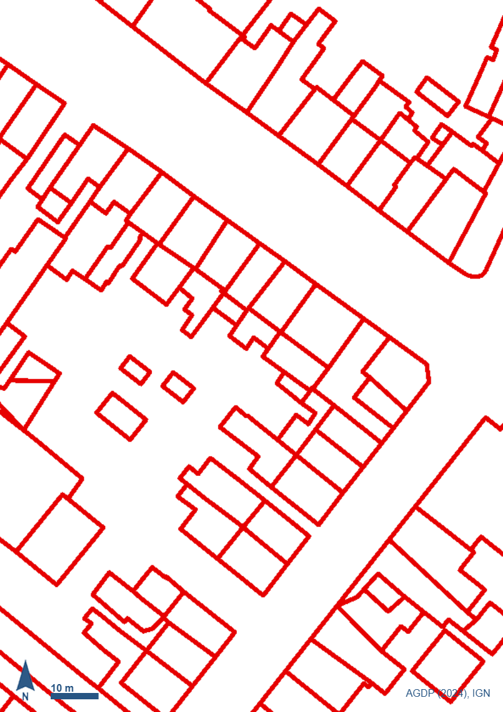
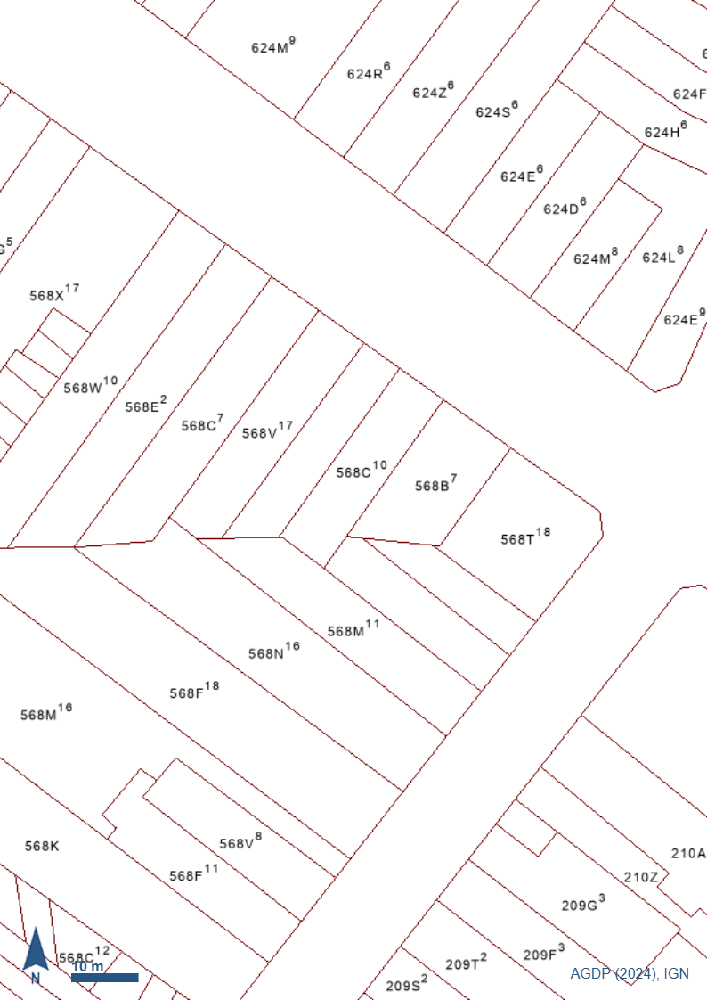
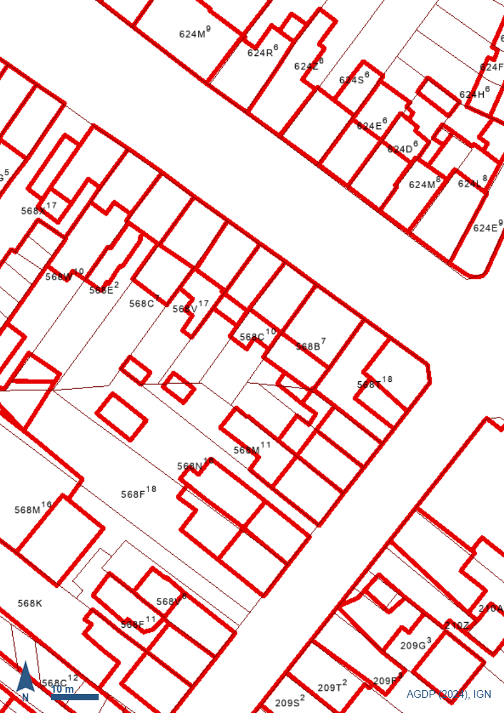
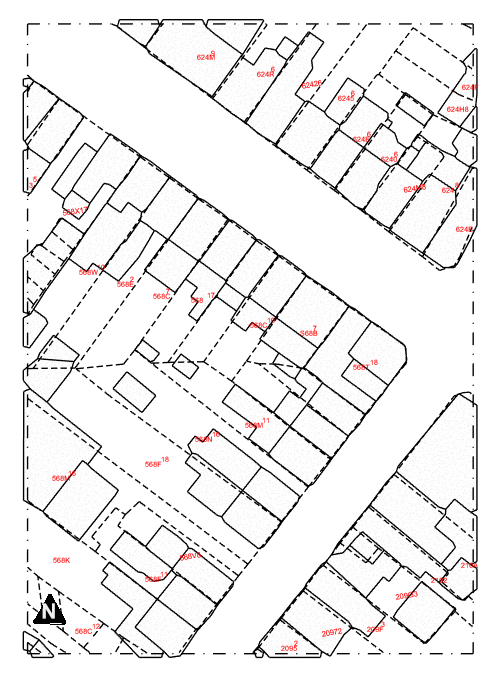

# pyKalfa

[Türkçe](README.md) · **English** · [Français](README.fr.md)

A pyRevit extension for Revit. Extracts parcel and building geometry from
cadastral images, and real walls from floor plan DXF files.

## Features

| Button | What it does |
| --- | --- |
| **Parsel/Bina Aktar** | Turns cadastral images (PNG) into Revit geometry: parcel boundaries as `DetailLine`, buildings as `FilledRegion`, parcel numbers as `TextNote`. |
| **Parsel/Bina GIS** | In Wallonia, fetches parcel boundaries, buildings and parcel numbers from the SPW geoportal by address or CaPaKey and draws them with the same styles as Parsel/Bina Aktar. No images or OCR needed. |
| **Duvar Aktar** | Converts walls in a floor plan DXF into real Revit `Wall` elements. |
| **Rölöve Aktar** | Quick as-built model from a Polycam scan into an empty project: measured levels, walls fitted to the scanned faces, doors/windows and named rooms. |

## Requirements

- Windows + Autodesk Revit
- [pyRevit](https://github.com/pyrevitlabs/pyRevit)
- [Python 3](https://www.python.org) — make sure **"Add python.exe to PATH"** is checked during setup

## Installation

1. In Revit, go to the **pyRevit** tab → **Extensions**.
2. Add a new extension using this URL:
   ```
   https://github.com/cmldk/pyKalfa.git
   ```
3. **Reload** pyRevit (or restart Revit).

The required Python packages are installed automatically on first
startup. This takes a few minutes (the OCR library is ~1-1.5 GB) and
shows a progress bar. It does not run again on later startups.

> Optional: you can also download it via **Code → Download ZIP**, rename
> the folder to `pyKalfa.extension`, and add its **parent** folder under
> pyRevit → Settings → *Custom Extension Folders*.

## Usage

### Parsel/Bina Aktar — parcels and buildings

| Input: buildings | Input: parcels | Input: both layers | Output: Revit |
| :---: | :---: | :---: | :---: |
|  |  |  |  |

Your own images should look like these examples in `assets/`: three PNGs
exported from the **same view** of the same cadastral extract, at the
**same pixel size**, with the scale bar visible.

The third image (both layers) is **not** a source of geometry; it is
used to align the two layers with each other. The building and parcel
images are exported separately, so there is no guarantee they show the
same frame — and a shifted parcel-to-building match does not look like
an error in the output. The third image removes that ambiguity; if the
alignment cannot be verified you get a warning.

1. Switch to a **plan, detail, section or elevation** view (it does not
   work in 3D views).
2. **pyKalfa** → **Parsel / Bina** → **Parsel/Bina Aktar**.
3. Provide the inputs as they are requested:
   - select the image with the **buildings only** (PNG)
   - select the image with the **parcels only** (PNG)
   - select the image with **both layers** (PNG)
   - enter the map scale denominator (`500` for 1:500)
   - pick a **Line Style** for parcel boundaries
   - pick a separate **Line Style** for the drawing frame (the outer
     border of the image) — choose the *"Cerceve cizme"* entry at the
     top of the list if you do not want a frame
   - pick a **Filled Region Type** for building units
   - pick a **Text Note Type** for parcel numbers
   - pick a **Generic Annotation** symbol for the north arrow — choose
     the *"Kuzey oku ekleme"* entry at the top of the list to skip it
4. Image processing runs behind a progress bar; you are not asked
   anything during this step.
5. The geometry is drawn and a summary of created elements appears.

> The north arrow, scale bar and credit line at the bottom of the image
> are not imported as geometry. Only the north arrow's **position and
> direction** are measured; the project's own symbol is placed there,
> turned the same way.

> In terraced blocks **each unit becomes its own Filled Region**, so the
> party walls between units are preserved. Two neighbouring units share
> the exact same edge, pixel for pixel, so no gap is left between them.

> Parcel numbers are read with OCR, which is about 80% accurate. Similar
> characters (G/6, A/4, B/8, S/5) may be confused — compare the result
> with the source image and correct it manually if needed.

### Parsel/Bina GIS — parcels and buildings from the geoportal

**Wallonia only**, and an internet connection is required. There are no
images, no scale and no OCR: parcel boundaries come from SPW
`CADMAP_PARCELLES`, buildings from SPW PICC, and parcel numbers from the
parcel's cadastral attributes.

1. Switch to a **plan, detail, section or elevation** view.
2. **pyKalfa** → **Parsel / Bina** → **Parsel/Bina GIS**.
3. In order:
   - type an **address** (e.g. `Rue du Parc 4, 4577 Modave`) or a
     **CaPaKey** (e.g. `92053D0515/00B002`)
   - pick one of the candidates found (you are asked again if none is
     found)
   - enter **how many metres** around the parcel to include (default 80,
     maximum 200)
   - a separate line style for the **selected parcel's outer boundary**
     (if skipped, the other parcels' style is used; its number is written
     like the others)
   - the **same style choices** as Parsel/Bina Aktar: parcel lines, frame
     (or *"Cerceve cizme"*), road and sidewalk edges (or *"Yol cizme"*),
     Text Note Type for street names (or *"Sokak adi yazma"*), building
     Filled Region Type, parcel number
     Text Note Type, north arrow (or *"Kuzey oku ekleme"*)
4. The data is fetched in a few seconds behind a progress bar, then drawn,
   and a summary opens.

> The drawing area is the selected parcel's bounding box grown by the
> margin; the frame is that rectangle, and neighbouring parcels and
> buildings that cross it are clipped at the frame. As in Parsel/Bina
> Aktar, the origin is the frame's bottom-left corner; the data is
> north-up, so the north arrow is placed at 0°.

> Road and sidewalk edges come from the PICC "Voirie - Ligne" layer (road
> edge, path edge, back edge of the sidewalk; kerb stones, parking bays,
> crossings etc. are not drawn). Street names come from the road axes: each
> name once, at the middle of its longest axis part, rotated along the road
> and centred. Rural areas where the PICC is not detailed may have no road
> lines.

> Parcel numbers come from the data, so there are no OCR errors. A check
> image is left at `output/revit_input_preview.png`.
>
> Source: Plan parcellaire cadastral © AGDP/SPF Finances, via SPW ;
> Bâtiments, voirie © SPW (PICC_VDIFF).

### Duvar Aktar — walls from DXF

1. Switch to a **plan view** for the level where the walls belong.
2. **pyKalfa** → **Duvar** → **Duvar Aktar**.
3. Then:
   - select the **DXF file**
   - *(if needed)* confirm the drawing units, moving the drawing to the
     origin, or single-line mode
   - choose the **layer** — the tool suggests the most likely wall
     layer. Doors and windows are drawn exactly like walls, so the layer
     is the only thing that separates them; this step matters
   - set the **wall height** and pick a **Level** and **Wall Type**
4. Confirm, and when it finishes you get the number of created and
   failed walls plus the total length.

> The whole import is a single transaction: if you do not like the
> result, a single **Ctrl+Z** in Revit undoes all of it.

### Rölöve Aktar — as-built model from a Polycam scan

Builds a quick starting model from a Polycam (iPhone/iPad LiDAR) scan.
The goal is a trustworthy survey: dimensions come from the scan, and
anything uncertain is flagged rather than invented.

**Required inputs** (Polycam Basic plan):

| Input | File | In Polycam |
|---|---|---|
| **Input 1** – Floor plan | `.dxf` (or the floor-plan `.zip`) | Floor plan → DXF |
| **Input 2** – Room list | `.csv` (taken from the floor-plan zip if it is there) | Floor plan → CSV |
| **Input 3** – Point cloud | `.laz` / `.las` — **georeferenced off** | Point cloud → LAS |
| **Input 4** – 3D model | `.glb` | Mesh → GLTF |

Polycam's OBJ (mesh) zip is not Input 1; it contains no DXF.

1. Open an empty project (the Architectural template is fine).
2. **pyKalfa** → **Duvar** → **Rolove Aktar** and pick **Input 1**.
   Inputs 2–4 with the same name in the same folder are suggested; the
   inputs window marks each one `OK` / `EKSIK` (missing), and any wrong or
   missing one can be picked with "Input N sec / degistir" (names need
   not match).
3. Preparation takes a few seconds (~5 s for the 4-storey sample). The
   summary shows the levels (main floor = 0.00), whether each floor
   aligned to the scan, and the wall statuses; levels can be edited. A
   PNG preview per floor is written to `output/`.
4. Pick the exterior wall type **once**, one type per interior thickness
   group, and the door and window families (or "Opening kullan").
5. Levels are named `Kat N (Scan)`; walls are created on their floor's
   level. Exterior walls grow **outward from the scanned interior face**
   (Location Line = Finish Face: Interior).

Every wall/door/window carries a `pyKalfa Tarama Durumu` parameter:
**olculdu** (measured from the LAZ), **duzeltildi** (DXF position
corrected from the scan), **varsayildi** (default or unverified — check
it). Use a view filter to colour them. Dimensions round to the nearest
5 cm and levels to 1 cm; positions are not rounded.

Running the button again in the same project is safe: elements created
earlier are kept (even if moved), ones you deleted do not come back, and
only missing ones are added.

## License

[MIT](LICENSE)
