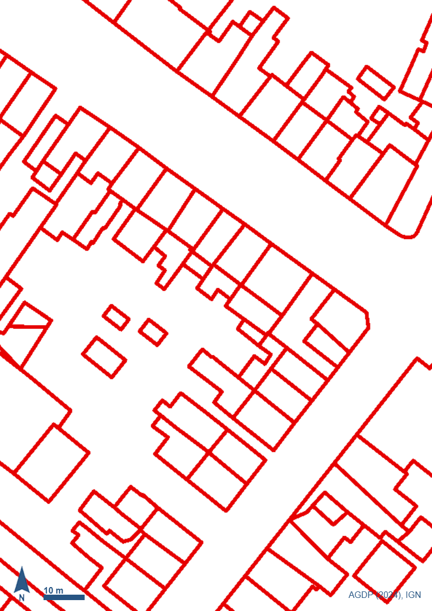
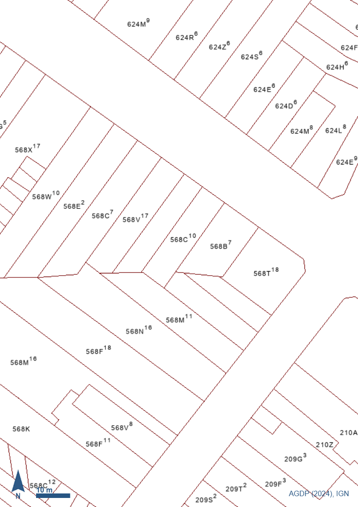
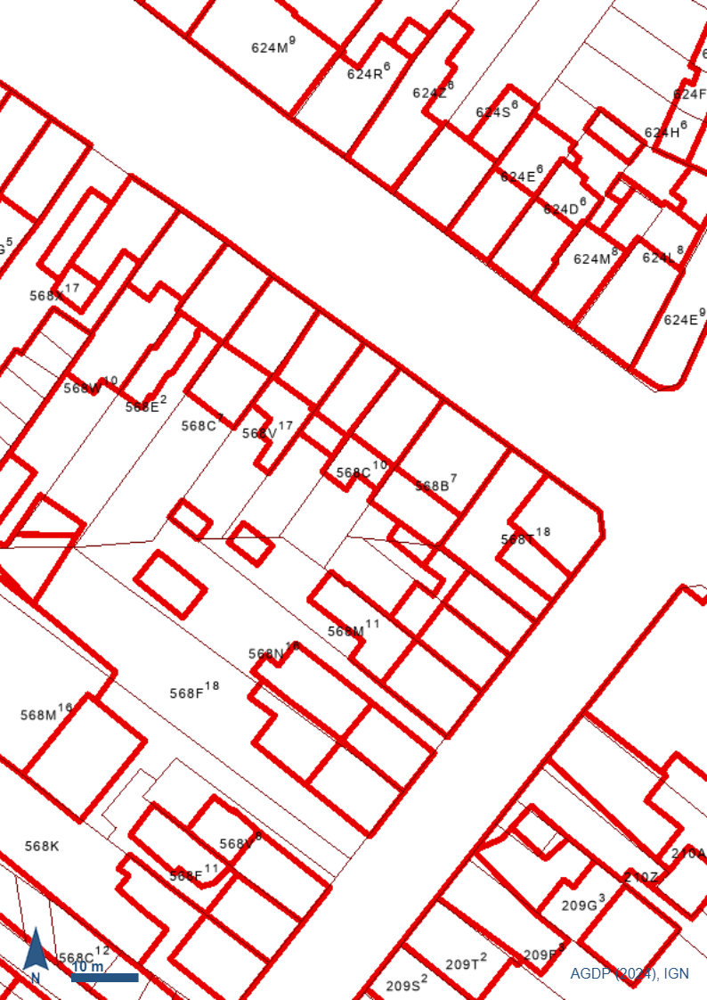
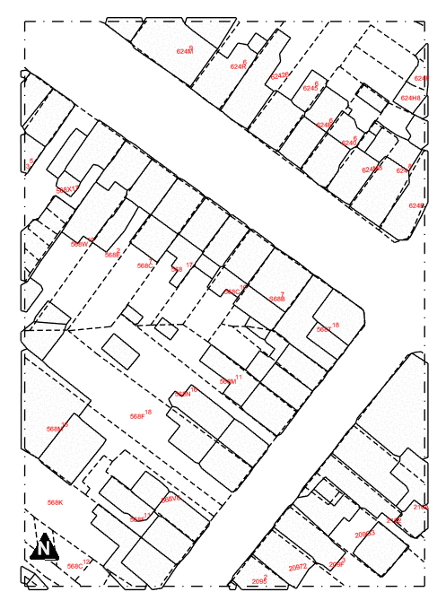

# pyKalfa

[Türkçe](README.md) · [English](README.en.md) · **Français**

Une extension pyRevit pour Revit. Elle extrait la géométrie des parcelles
et des bâtiments à partir d'images cadastrales, et de vrais murs à partir
de fichiers DXF de plans d'étage.

## Fonctionnalités

| Bouton | Rôle |
| --- | --- |
| **Parsel/Bina Aktar** | Convertit des images cadastrales (PNG) en géométrie Revit : limites de parcelles en `DetailLine`, bâtiments en `FilledRegion`, numéros de parcelles en `TextNote`. |
| **Parsel/Bina GIS** | En Wallonie, récupère les limites de parcelles, les bâtiments et les numéros de parcelles depuis le géoportail du SPW à partir d'une adresse ou d'un CaPaKey, et les dessine avec les mêmes styles que Parsel/Bina Aktar. Ni images ni OCR. |
| **Duvar Aktar** | Convertit les murs d'un plan d'étage DXF en véritables éléments `Wall` de Revit. |
| **Rölöve Aktar** | Relevé rapide depuis un scan Polycam dans un projet vide : niveaux mesurés, murs calés sur les faces scannées, portes/fenêtres et pièces nommées. |

## Prérequis

- Windows + Autodesk Revit
- [pyRevit](https://github.com/pyrevitlabs/pyRevit)
- [Python 3](https://www.python.org) — cochez bien **« Add python.exe to PATH »** lors de l'installation

## Installation

1. Dans Revit, onglet **pyRevit** → **Extensions**.
2. Ajoutez une nouvelle extension avec cette adresse :
   ```
   https://github.com/cmldk/pyKalfa.git
   ```
3. Faites **Reload** (ou redémarrez Revit).

Les paquets Python nécessaires sont installés automatiquement au premier
démarrage. Cela prend quelques minutes (la bibliothèque OCR pèse environ
1 à 1,5 Go) et une barre de progression s'affiche. L'opération ne se
répète pas aux démarrages suivants.

> Facultatif : vous pouvez aussi télécharger le dossier via **Code →
> Download ZIP**, le renommer en `pyKalfa.extension` et ajouter son
> dossier **parent** dans pyRevit → Settings → *Custom Extension
> Folders*.

## Utilisation

### Parsel/Bina Aktar — parcelles et bâtiments

| Entrée : bâtiments | Entrée : parcelles | Entrée : les deux calques | Sortie : Revit |
| :---: | :---: | :---: | :---: |
|  |  |  |  |

Vos propres images doivent ressembler à ces exemples du dossier
`assets/` : trois PNG exportés depuis la **même vue** du même extrait
cadastral, à la **même taille en pixels**, avec l'échelle graphique
visible.

La troisième image (les deux calques) n'est **pas** une source de
géométrie : elle sert à caler les deux calques l'un sur l'autre. Les
images des bâtiments et des parcelles étant exportées séparément, rien
ne garantit qu'elles montrent le même cadrage — et une association
parcelle-bâtiment décalée ne ressemble pas à une erreur dans le
résultat. La troisième image lève cette ambiguïté ; si le calage ne
peut pas être vérifié, un avertissement s'affiche.

1. Placez-vous dans une vue en **plan, de détail, en coupe ou en
   élévation** (cela ne fonctionne pas en vue 3D).
2. **pyKalfa** → **Parsel / Bina** → **Parsel/Bina Aktar**.
3. Renseignez les entrées au fur et à mesure :
   - sélectionnez l'image contenant **uniquement les bâtiments** (PNG)
   - sélectionnez l'image contenant **uniquement les parcelles** (PNG)
   - sélectionnez l'image contenant **les deux calques** (PNG)
   - saisissez le dénominateur de l'échelle (`500` pour 1:500)
   - choisissez un **Line Style** pour les limites de parcelles
   - choisissez un **Line Style** distinct pour le cadre du dessin (la
     bordure extérieure de l'image) — sélectionnez l'entrée *"Cerceve
     cizme"* en tête de liste si vous n'en voulez pas
   - choisissez un **Filled Region Type** pour les unités bâties
   - choisissez un **Text Note Type** pour les numéros de parcelles
   - choisissez un symbole **Generic Annotation** pour la flèche du nord
     — sélectionnez l'entrée *"Kuzey oku ekleme"* en tête de liste pour
     l'ignorer
4. Le traitement d'image s'exécute derrière une barre de progression ;
   aucune question ne vous est posée pendant cette étape.
5. La géométrie est dessinée, puis un résumé des éléments créés
   s'affiche.

> La flèche du nord, l'échelle graphique et la mention de source en bas
> de l'image ne sont pas importées comme géométrie. Seuls la **position
> et l'orientation** de la flèche du nord sont mesurées ; le symbole
> propre au projet est placé au même endroit, tourné dans le même sens.

> Dans les îlots mitoyens, **chaque unité devient sa propre Filled
> Region** : les murs mitoyens sont conservés. Deux unités voisines
> partagent exactement la même arête, pixel par pixel, sans laisser de
> vide entre elles.

> Les numéros de parcelles sont lus par OCR, avec une précision
> d'environ 80 %. Des caractères proches (G/6, A/4, B/8, S/5) peuvent
> être confondus : comparez le résultat avec l'image source et corrigez
> manuellement si nécessaire.

### Parsel/Bina GIS — parcelles et bâtiments depuis le géoportail

**Wallonie uniquement**, connexion internet requise. Pas d'images, pas
d'échelle, pas d'OCR : les limites de parcelles viennent du SPW
`CADMAP_PARCELLES`, les bâtiments du PICC du SPW et les numéros des
attributs cadastraux de la parcelle.

1. Passez dans une vue **en plan, de détail, en coupe ou en élévation**.
2. **pyKalfa** → **Parsel / Bina** → **Parsel/Bina GIS**.
3. Dans l'ordre :
   - saisissez une **adresse** (p. ex. `Rue du Parc 4, 4577 Modave`) ou
     un **CaPaKey** (p. ex. `92053D0515/00B002`)
   - choisissez l'un des résultats (la question est reposée si rien n'est
     trouvé)
   - indiquez **combien de mètres** autour de la parcelle inclure (80 par
     défaut, 200 au maximum)
   - un line style distinct pour la **limite extérieure de la parcelle
     choisie** (si ignoré, le style des autres parcelles est utilisé ; son
     numéro est écrit comme les autres)
   - les **mêmes choix de styles** que Parsel/Bina Aktar : lignes de
     parcelles, cadre (ou *« Cerceve cizme »*), bords de voirie et de
     trottoir (ou *« Yol cizme »*), Text Note Type des noms de rues (ou
     *« Sokak adi yazma »*), Filled Region Type des
     bâtiments, Text Note Type des numéros, flèche du nord (ou *« Kuzey
     oku ekleme »*)
4. Les données sont récupérées en quelques secondes avec une barre de
   progression, puis dessinées ; un récapitulatif s'ouvre.

> La zone dessinée est le rectangle englobant de la parcelle choisie,
> agrandi de la marge ; le cadre est ce rectangle, et les parcelles et
> bâtiments voisins qui le traversent y sont découpés. Comme dans
> Parsel/Bina Aktar, l'origine est le coin inférieur gauche du cadre ; les
> données sont orientées nord en haut, la flèche du nord est donc posée à
> 0°.

> Les bords de voirie et de trottoir viennent de la couche PICC « Voirie -
> Ligne » (bord de voirie, bord de chemin, arrière du trottoir ; bordures,
> parkings, passages piétons, etc. ne sont pas dessinés). Les noms de rues
> viennent des axes de voirie : chaque nom une fois, au milieu de sa plus
> longue partie d'axe, tourné dans le sens de la rue et centré. En zone
> rurale peu détaillée au PICC, il peut n'y avoir aucune ligne de voirie.

> Les numéros de parcelles viennent des données : aucune erreur d'OCR.
> Une image de contrôle est laissée dans `output/revit_input_preview.png`.
>
> Source : Plan parcellaire cadastral © AGDP/SPF Finances, via SPW ;
> Bâtiments, voirie © SPW (PICC_VDIFF).

### Duvar Aktar — murs à partir d'un DXF

1. Placez-vous dans une **vue en plan** correspondant au niveau des
   murs.
2. **pyKalfa** → **Duvar** → **Duvar Aktar**.
3. Ensuite :
   - sélectionnez le **fichier DXF**
   - *(si nécessaire)* confirmez l'unité du dessin, le recentrage vers
     l'origine ou le mode ligne simple
   - choisissez le **calque** — l'outil propose le calque de murs le
     plus probable. Les portes et fenêtres étant dessinées exactement
     comme les murs, seul le calque permet de les distinguer : cette
     étape est importante
   - indiquez la **hauteur de mur**, puis choisissez un **Level** et un
     **Wall Type**
4. Validez ; à la fin, le nombre de murs créés et échoués ainsi que la
   longueur totale s'affichent.

> L'import complet forme une seule transaction : si le résultat ne vous
> convient pas, un simple **Ctrl+Z** dans Revit annule tout.

### Rölöve Aktar — relevé depuis un scan Polycam

Produit un modèle de départ rapide à partir d'un scan Polycam (LiDAR
iPhone/iPad). L'objectif est un relevé fiable : les cotes viennent du
scan, ce qui est incertain est signalé, pas inventé.

**Exports Polycam requis** (offre Basic ; même dossier, même nom) :

| Fichier | Dans Polycam |
|---|---|
| `<nom>.dxf` + `<nom>.csv` | Floor plan → DXF / CSV (le zip du plan convient aussi) |
| `<nom>.laz` | Point cloud → LAS — **géoréférencement désactivé** (`<nom> georef.laz` n'est pas utilisé) |
| `<nom>.glb` | Mesh → GLTF |

1. Ouvrez un projet vide (le gabarit Architectural suffit).
2. **pyKalfa** → **Duvar** → **Rolove Aktar** et choisissez le DXF (ou le
   zip) ; les autres fichiers sont trouvés automatiquement, les fichiers
   manquants sont indiqués.
3. La préparation prend quelques secondes (~5 s pour l'exemple de 4
   niveaux). Le résumé affiche les niveaux (étage principal = 0.00), le
   calage de chaque étage sur le scan et l'état des murs ; les niveaux
   sont modifiables. Un aperçu PNG par étage est écrit dans `output/`.
4. Choisissez le type de mur extérieur **une fois**, un type par groupe
   d'épaisseur intérieure, puis les familles de portes et de fenêtres
   (ou « Opening kullan »).
5. Les niveaux s'appellent `Kat N (Scan)` ; chaque mur est créé sur le
   niveau de son étage. Les murs extérieurs s'épaississent **vers
   l'extérieur depuis la face intérieure scannée** (Location Line =
   Finish Face: Interior).

Chaque mur/porte/fenêtre porte le paramètre `pyKalfa Tarama Durumu` :
**olculdu** (mesuré dans le LAZ), **duzeltildi** (position du DXF
corrigée par le scan), **varsayildi** (valeur par défaut ou non vérifiée
— à contrôler). Un filtre de vue permet de les colorer. Les cotes sont
arrondies aux 5 cm les plus proches, les niveaux au cm ; les positions ne
sont pas arrondies.

Relancer le bouton dans le même projet est sans risque : les éléments
déjà créés sont conservés (même déplacés), ceux que vous avez supprimés
ne reviennent pas, seuls les manquants sont ajoutés.

## Licence

[MIT](LICENSE)
