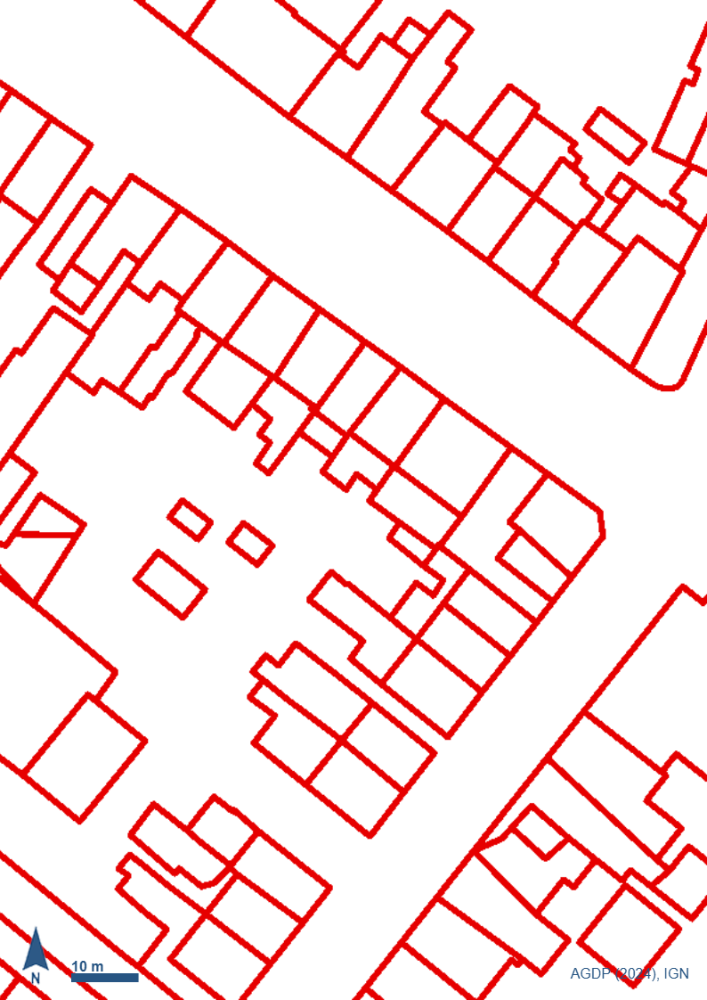
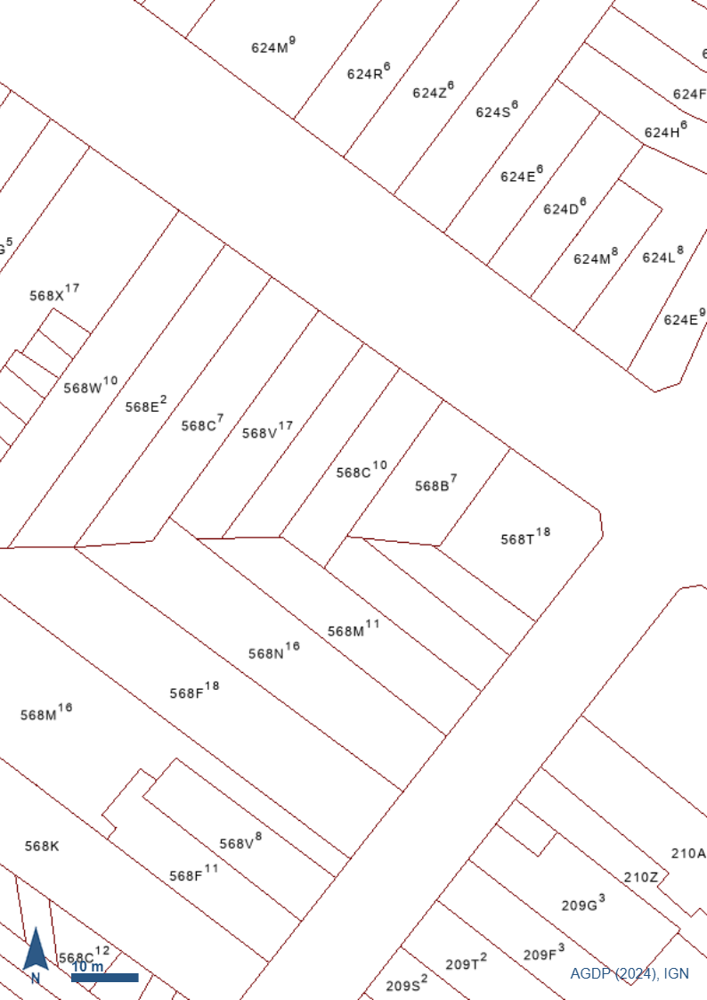
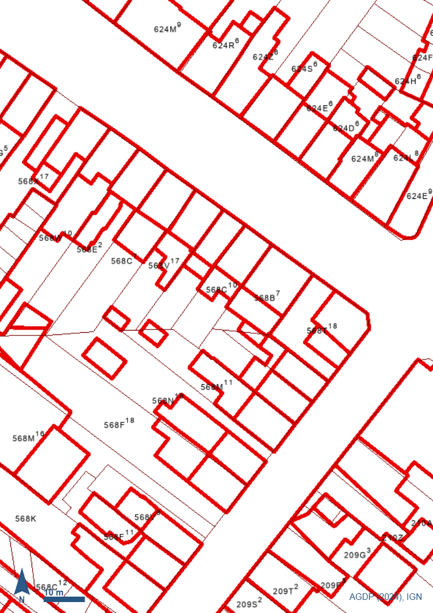
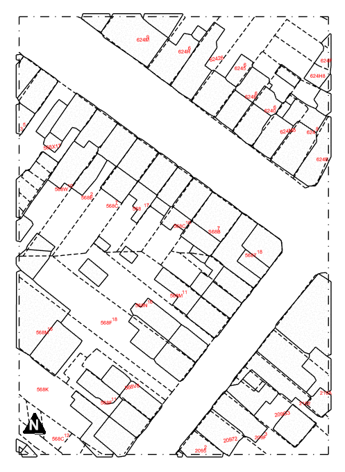

# pyKalfa

**Türkçe** · [English](README.en.md) · [Français](README.fr.md)

Revit için pyRevit eklentisi. Kadastro verisinden parsel ve bina
geometrisi, Polycam taramasından da döşemeli bir bina prototipi üretir.

## Özellikler

| Buton | Ne yapar |
| --- | --- |
| **Parsel/Bina Aktar** | Kadastro görüntülerinden (PNG) parsel sınırlarını `DetailLine`, bina alanlarını `FilledRegion`, parsel numaralarını `TextNote` olarak Revit'e çizer. |
| **Parsel/Bina GIS** | Valonya ve Flaman bölgesinde adres veya CaPaKey ile bölgenin GIS servislerinden parsel sınırlarını, binaları ve parsel numaralarını alıp Parsel/Bina Aktar ile aynı stillerle çizer. OCR ve görsel gerekmez. |
| **Rölöve Prototip** | Aynı Polycam taramasından toparlanmış, döşemeli hızlı prototip: dik köşeler, katlar arası hizalı dış duvarlar, her katta döşeme. |

## Gereksinimler

- Windows + Autodesk Revit
- [pyRevit](https://github.com/pyrevitlabs/pyRevit)
- [Python 3](https://www.python.org) — kurulumda **"Add python.exe to PATH"** işaretli olmalı

## Kurulum

1. Revit'te **pyRevit** sekmesi → **Extensions**.
2. Yeni eklenti olarak şu adresi girin:
   ```
   https://github.com/cmldk/pyKalfa.git
   ```
3. **Reload** edin (veya Revit'i yeniden başlatın).

İlk açılışta gerekli Python paketleri otomatik kurulur. Bu birkaç dakika
sürer (OCR kütüphanesi ~1-1.5 GB) ve bir ilerleme çubuğu gösterilir.
Sonraki açılışlarda kurulum tekrarlanmaz.

> İsteğe bağlı: **Code → Download ZIP** ile indirip klasör adını
> `pyKalfa.extension` yapıp pyRevit → Settings → *Custom Extension
> Folders*'a bu klasörün **üst** klasörünü de ekleyebilirsiniz.

## Kullanım

### Parsel/Bina Aktar

| Girdi: bina | Girdi: parsel | Girdi: ikisi birlikte | Çıktı: Revit |
| :---: | :---: | :---: | :---: |
|  |  |  |  |

Kendi görselleriniz `assets/` klasöründeki bu örneklere benzer
olmalıdır: aynı kadastro kesitinin **aynı görünümünden** dışa
aktarılmış üç PNG, **aynı piksel boyutunda** ve ölçek çubuğu görünür
durumda.

Üçüncü görsel (ikisi birlikte) geometri kaynağı **değildir**; iki
katmanı birbirine hizalamak için kullanılır. Bina ve parsel görselleri
ayrı ayrı dışa aktarıldığı için aynı kadrajı gösterdikleri garanti
değildir, kaymış bir parsel-bina eşleşmesi de çıktıda hata gibi
görünmez. Üçüncü görsel bu belirsizliği ortadan kaldırır; hizalama
doğrulanamazsa uyarı verilir.

1. **Plan, detay, kesit veya cephe** görünümüne geçin (3D görünümde
   çalışmaz).
2. **pyKalfa** → **Parsel / Bina** → **Parsel/Bina Aktar**.
3. Sırasıyla sorulan girdileri verin:
   - yalnızca **bina** katmanını içeren görseli (PNG) seçin
   - yalnızca **parsel** katmanını içeren görseli (PNG) seçin
   - **ikisini birlikte** içeren görseli (PNG) seçin
   - harita ölçeğinin paydasını yazın (1:500 için `500`)
   - parsel çizgileri için bir **Line Style** seçin
   - çizim çerçevesi (görüntünün dış sınırı) için ayrı bir **Line
     Style** seçin — çerçeve istemiyorsanız listenin başındaki
     *"Cerceve cizme"* seçeneğini işaretleyin
   - bina birimleri için bir **Filled Region Type** seçin
   - parsel numaraları için bir **Text Note Type** seçin
   - kuzey oku için bir **Generic Annotation** sembolü seçin —
     istemiyorsanız listenin başındaki *"Kuzey oku ekleme"* seçeneğini
     işaretleyin
4. Görüntü işleme bir ilerleme çubuğuyla çalışır; bu sırada soru
   sorulmaz.
5. Geometri çizilir ve kaç eleman oluştuğunu gösteren özet açılır.

> Görselin alt kısmındaki kuzey oku, ölçek çubuğu ve künye yazısı
> geometriye dahil edilmez. Kuzey okunun yalnızca **konumu ve yönü**
> ölçülür; çizime projenin kendi sembolü aynı yöne çevrilerek konur.

> Bitişik yapılarda (sıra ev blokları) **her birim ayrı bir Filled
> Region** olur; aradaki bölme (parti) duvarları korunur. Komşu iki
> birimin ortak kenarı piksel piksel aynı çizgiden geldiği için
> aralarında boşluk kalmaz.

> Parsel numaraları OCR ile okunur, doğruluk ~%80'dir. Benzer
> karakterler (G/6, A/4, B/8, S/5) karışabilir; sonucu kaynak görselle
> karşılaştırıp gerekirse elle düzeltin.

### Parsel/Bina GIS

**Valonya** ve **Flaman bölgesi** için; internet bağlantısı gerekir.
Görüntü, ölçek ve OCR yoktur. Adres adayları iki bölgeden aynı listede
gelir (her satırda bölge yazar); CaPaKey önce Valonya'da, sonra Flaman
bölgesinde aranır. Brüksel desteklenmez.

| | Valonya | Flaman bölgesi |
|---|---|---|
| Adres | ICAR (SPW) | Digitaal Vlaanderen (geolocation) |
| Parsel | SPW `CADMAP_PARCELLES` | Adpf (idari parseller) |
| Bina | SPW PICC | GRB `GBG` |
| Yol / kaldırım kenarı | PICC "Voirie - Ligne" | GRB `WGO` |
| Sokak adı | PICC yol ekseni | GRB `Wegsegment` |

Parsel numaraları iki bölgede de CaPaKey'den çözülür.

1. **Plan, detay, kesit veya cephe** görünümüne geçin.
2. **pyKalfa** → **Parsel / Bina** → **Parsel/Bina GIS**.
3. Sırasıyla:
   - **adres** (ör. `Rue du Parc 4, 4577 Modave`, `Steenstraat 10, 8000
     Brugge`) veya **CaPaKey**
     (ör. `92053D0515/00B002`) yazın
   - bulunan adaylardan birini seçin (bulunamazsa tekrar sorulur)
   - parselin etrafında **kaç metre** alınacağını yazın (varsayılan 80,
     en fazla 200)
   - **seçilen parselin dış sınırı** için ayrı line style (atlanırsa diğer
     parsellerle aynı stil kullanılır; numarası diğerleriyle aynı yazılır)
   - Parsel/Bina Aktar'daki **aynı stil seçimleri**: parsel çizgileri,
     çerçeve (veya *"Cerceve cizme"*), yol ve kaldırım kenarları (veya
     *"Yol cizme"*), sokak adları için Text Note Type (veya *"Sokak adi
     yazma"*), bina Filled Region Type, parsel
     numarası Text Note Type, kuzey oku (veya *"Kuzey oku ekleme"*)
4. Veri birkaç saniyede bir ilerleme çubuğuyla alınır, sonra çizilir ve
   özet açılır.

> Çizim alanı, seçilen parselin sınır kutusunun verilen pay kadar
> büyütülmüş hâlidir; çerçeve bu dikdörtgendir ve onu kesen komşu
> parseller ile binalar çerçevede kırpılır. Orijin Parsel/Bina Aktar'daki
> gibi çerçevenin sol-alt köşesidir; veri kuzey yukarı olduğu için kuzey
> oku 0° konur.

> Yol ve kaldırım kenarları PICC "Voirie - Ligne" katmanından gelir (yol
> kenarı, patika kenarı, kaldırım arka kenarı; bordür, park yeri, yaya geçidi
> vb. çizilmez). Sokak adları yol eksenlerinden gelir: her ad bir kez, en uzun
> eksen parçasının ortasına, yol yönünde döndürülmüş ve ortalanmış yazılır.
> PICC'nin ayrıntılı olmadığı kırsal yerlerde yol çizgisi çıkmayabilir.
> Flaman bölgesinde yol kenarları GRB `WGO` katmanının üç türüdür: rijbaan
> kenarı, yaya/bisiklet bölgesi (kaldırım) sınırı, stabilize bölge sınırı.

> Parsel numaraları veriden okunduğu için OCR hatası yoktur. Kontrol için
> `output/revit_input_preview.png` görseli bırakılır.
>
> Kaynak — Valonya: Plan parcellaire cadastral © AGDP/SPF Finances, via SPW ;
> Bâtiments, voirie © SPW (PICC_VDIFF). Flaman: Adpf © AAPD/FOD Financiën,
> via Digitaal Vlaanderen ; GRB © Digitaal Vlaanderen.

### Rölöve Prototip

Polycam (iPhone/iPad LiDAR) taramasından boş projeye **hızlı bir başlangıç
kütlesi** üretir: duvarlar, döşemeler, kapı/pencere ve adlı odalar. Ölçü
belgesi değildir; ince ölçüler sonradan elle düzeltilir.

**Gereken girdiler** (Polycam Basic plan):

| Girdi | Dosya | Polycam'de |
|---|---|---|
| **Input 1** – Kat planı | `.dxf` (ya da kat planı `.zip`'i) | Floor plan → DXF |
| **Input 2** – Oda listesi | `.csv` (kat planı zip'indeyse oradan alınır) | Floor plan → CSV |
| **Input 3** – Nokta bulutu | `.laz` / `.las` — **georeferenced kapalı** | Point cloud → LAS |
| **Input 4** – 3B model | `.glb` | Mesh → GLTF |

Polycam'in OBJ (mesh) zip'i Input 1 değildir; içinde DXF yoktur.

- **Ölçü:** her katın duvarları taramaya oturtulur, kat kotları taramadan
  ölçülür (ana kat = 0.00).
- **Toparlama:** neredeyse dik köşeler (5°'ye kadar) 90°'ye, katlar arası
  birbirine 15 cm'den yakın dış duvarlar aynı hatta oturur. Daha eğik
  duvarlar olduğu gibi kalır; taramada kapalı köşeler kapalı kalır.
- **Döşeme:** her katın Level'ına bir döşeme (tipini siz seçersiniz); üst
  yüzü kat kotunda, dış duvarın dış yüzüne kadar. Bir katın döşemesi o
  katın ve altındaki katın izini örter (üstü açık kalan kısım düz çatı
  varsayılır).
- **Duvarlar** üst katın Level'ına bağlanır ve döşemenin altında biter;
  en üst katın duvarları taranan yükseklikte kalır. Dış duvarlar taranan
  **iç yüzden dışa doğru** kalınlaşır. Döşeme tipini sonradan
  değiştirirseniz duvarların üst ofsetini de güncelleyin.
- Çatı, merdiven ve merdiven boşluğu yok.

1. Boş bir proje açın (Architectural şablon yeterli).
2. **pyKalfa** → **Duvar** → **Rolove Prototip** ve **Input 1**'i seçin.
   Aynı klasörde aynı adlı Input 2–4 kendiliğinden önerilir; girdi
   penceresi her birini `OK` / `EKSIK` olarak gösterir, yanlış ya da eksik
   olanı "Input N seç / değiştir" ile seçin.
3. Özet penceresi kat kotlarını ve toparlama sayılarını gösterir; kotlar
   düzeltilebilir. Kat başına `prototip_preview_katN.png` yazılır.
4. Dış duvar tipini **bir kez**, her iç duvar kalınlık grubu için bir tip,
   kapı ve pencere ailesini (ya da "Opening kullan") ve **döşeme tipini**
   seçin. İşlem tek **Ctrl+Z** ile geri alınabilir.

Her duvar/kapı/pencere `pyKalfa Tarama Durumu` parametresini taşır:
**olculdu** (taramadan ölçüldü), **duzeltildi** (konumu taramaya göre ya da
toparlamada düzeltildi; sapma cm olarak yazılır), **varsayildi**
(varsayılan ya da doğrulanamadı — kontrol edin). Görünüm filtresiyle
renklendirilebilir.

Butonu aynı projede tekrar çalıştırmak güvenlidir: daha önce oluşturulan
elemanlar korunur, sildikleriniz geri gelmez, yalnız eksikler eklenir.

## Lisans

[MIT](LICENSE)
